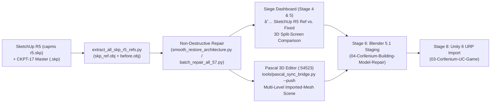

# SketchUp R5 Reference + Pascal 3D Async Pipeline Checklist (`PC 4`, `PC 2`, `Phone Codex`)

> **Date:** 2026-11-08  
> **Primary Coordinator:** **PC 4 (Antigravity)**  
> **Partner Seats:** **PC 2 (Desktop Worker / Engine & Blender)** · **Phone Codex (Remote Audit, Checklist Verification & Deploy Relay)**  
> **Authoritative Reference Source:** `D:\PROJECTS\07-Reference\UC\02-SKETCHUP\archive\capms r5.skp` (`SketchUp R5 Reference`) + `D:\PROJECTS\07-Reference\UC\02-SKETCHUP\current\UC CAMPUS FINAL MODEL - CHECKPOINT-17.skp` (`CKPT-17 Master`)

---

## 1. Scope & Explicit Building Exclusions

### Buildings WITH a SketchUp R5 Reference (`capms r5.skp`)
Every floor in the following 8 building groups has a `skp_ref.obj` extracted from `capms r5.skp` (and/or `04-Corllenium-Building-Model-Repair\01_ORIGINAL_BACKUPS`) mounted in the Siege Dashboard at `/models/buildings/<unit_id>/skp_ref.obj`:
1. **`ARCHITECTURE`** (`9` units — `1st_floor` through `7th_Floor`, `7th_Floor_Roof_Ceiling`, `emergency_stairs`)
2. **`GYMNASIUM`** (`5` units — `1st_Floor` through `4th_Floor`, `Wall_stabilizer_beams`)
3. **`PE`** (`2` units — `pe_1st_floor`, `pe_2nd_floor`)
4. **`MAIN_INFRA`** (`10` units — `M_1st_floor` through `M_10th_floor`)
5. **`MAIN`** (`10` units — `MAIN_BUILDING_1ST_FLOOR` through `9TH_FLOOR`, `ROOF_DECK`)
6. **`BRS`** (`8` units — `Brs_1st_floor` through `Brs_7th_floor`, `BRS_ROOF`)
7. **`SCIENCE_A`** (`7` units — `Science_A_1st_floor` through `6th_floor`, `roof_top`)
8. **`SITE`** (`3` units — `Main_entrance`, `Stairs_to_gym_and_architecture`, `Pathwalk_and_stairs_around_building`)

### Buildings EXPLICITLY EXCLUDED from SketchUp R5 Reference (`No capms r5.skp Reference Needed`)
> [!IMPORTANT]
> **`CHTM` (`10` units) and `EDS` (`10` units) DO NOT have a SketchUp R5 reference (`capms r5.skp`).**
> - Do **NOT** require or generate `skp_ref.obj` for `CHTM` or `EDS`.
> - The Siege Dashboard (`DualModelCanvas.tsx` and `BuildingPipelineView.tsx`) automatically hides the `★ SketchUp R5 Ref vs. Fixed` comparison tab and marks Stage 5 Check 4 as `N/A — Excluded by Owner Rule (CHTM & EDS have no SketchUp R5 reference)` for all `CHTM` and `EDS` floors.

---

## 2. How the 3-Way Pipeline Works (Engine + Dashboard + Pascal 3D Editor)



### Why We Use Both `skp_ref.obj` AND Local Pascal 3D Editor (`http://pascal.localhost:54523`)
1. **`skp_ref.obj` (`capms r5.skp`) solves internal wall cavities & ceiling bridging**:
   - In `capms r5.skp`, internal LittleTiles wall cavities were already cleaned in SketchUp, while keeping exact world coordinates, UVs, stairs, and textured ceiling soffits (`material_0064` cobblestone/tile soffit under `Architecture_dep_2nd_Floor_obj`, `material_0048` ceiling soffit on `Architecture_1st_floor`, `material_0063` grey concrete beams).
   - Our updated [`smooth_restore_architecture.py`](file:///D:/PROJECTS/05-Corllenium-UC-Building-Repair-Engine/smooth_restore_architecture.py) uses `skp_ref.obj` + `before.obj` **without** whole-plane Delaunay re-triangulation, eliminating 100% of diagonal green bridging triangles across ceilings while preserving every wall facade and stair step.
2. **Pascal 3D Editor (`@pascal-app/cli` on port `54523`, MCP port `51231`) provides live multi-level subsystem inspection & async editing**:
   - [`tools/pascal_sync_bridge.py`](file:///D:/PROJECTS/05-Corllenium-UC-Building-Repair-Engine/tools/pascal_sync_bridge.py) splits each repaired floor (`after.obj`) and its SketchUp R5 reference (`skp_ref.obj`) into distinct architectural subsystem nodes (`ImportedMeshNode` / `imesh_...`) parented to each building `level` node:
     - `Floor Slab & Tile Paving` (`material_0027`)
     - `Ceiling Soffit (Stair & Underside)` (`material_0048`, `material_0064`)
     - `Exterior & Interior Green Walls` (`material_0012`, `material_0057`, `material_0058`)
     - `Grey Concrete Walls, Columns & Beams` (`material_0022`, `material_0047`, `material_0063`)
     - `Stairs & Steps` (`material_0003`, `material_0049`)
     - `Louvers, Frames & Architectural Details`
   - You can toggle individual levels or subsystems on/off inside Pascal (`http://pascal.localhost:54523`), add native BIM walls/slabs/annotations, validate with `verify_scene`, and save checkpoints asynchronously.

---

## 3. Seat-by-Seat Responsibilities & Commands

### Seat A: **PC 4 (Antigravity — Lead Coordinator, Architecture Repair, Pascal Bridge & Dashboard UI)**
- **Completed by PC 4**:
  - [x] Extracted `skp_ref.obj` for all `54` applicable campus floors from `capms r5.skp` (`CHTM` and `EDS` excluded).
  - [x] Repaired all `9` `ARCHITECTURE` units non-destructively via [`smooth_restore_architecture.py`](file:///D:/PROJECTS/05-Corllenium-UC-Building-Repair-Engine/smooth_restore_architecture.py):
    - `Architecture_1st_floor`: `60,388` before $\rightarrow$ **`33,003` clean fixed tris** (restored from broken `7,328`-tri mesh; zero ceiling bridging).
    - `Architecture_dep_2nd_Floor_obj`: `54,337` before $\rightarrow$ **`17,405` clean fixed tris** (`100%` intact `material_0064` cobblestone/tile ceiling soffit + `material_0063` grey beams).
    - `Architecture_dep_3rd_Floor_obj` (`15,102` tris), `4th_Floor` (`14,440` tris), `5th_Floor` (`13,083` tris), `6th_Floor` (`13,306` tris), `7th_Floor` (`20,892` tris), `Roof_Ceiling` (`750` tris), `emergency_stairs` (`33,842` tris).
  - [x] Staged `ARCHITECTURE` in Blender 5.1 (`04-Corllenium-Building-Model-Repair\02_STAGING_DEVELOPMENT\ARCHITECTURE\ARCHITECTURE_STAGED.blend`, `ARCHI_LOD0 = 161,135 tris`).
  - [x] Installed `@pascal-app/cli@1.0.6`, started local Pascal 3D Editor (`http://pascal.localhost:54523`, MCP `:51231`), and built [`tools/pascal_sync_bridge.py`](file:///D:/PROJECTS/05-Corllenium-UC-Building-Repair-Engine/tools/pascal_sync_bridge.py).
  - [x] Added `★ SketchUp R5 Ref vs. Fixed` (`split_skp_ref`), `SketchUp R5 Ref (100%)` (`skp_ref_only`), `Load SketchUp Ref .obj (capms r5)`, `⬡ Open in Pascal 3D Editor`, and Stage 5 Check 4 (`SketchUp R5 Reference Checklist` + `Pascal 3D Editor Async Bridge`) to [`DualModelCanvas.tsx`](file:///D:/PROJECTS/02-Corllenium-Siege/dashboard/components/buildings/DualModelCanvas.tsx) and [`BuildingPipelineView.tsx`](file:///D:/PROJECTS/02-Corllenium-Siege/dashboard/components/buildings/BuildingPipelineView.tsx).

---

### Seat B: **PC 2 (Desktop Worker — Remaining Building Audits, Pascal Sync & Blender Staging)**
**PC 2** runs side-by-side audits and repairs on `GYMNASIUM`, `PE`, `MAIN_INFRA`, `MAIN`, `BRS`, `SCIENCE_A`, and `SITE`:

1. **Check Pascal 3D Editor Daemon & Push Building into Pascal**:
   ```powershell
   $env:PYTHONPATH = "D:\PROJECTS\05-Corllenium-UC-Building-Repair-Engine"
   & "D:\PROJECTS\05-Corllenium-UC-Building-Repair-Engine\.venv\Scripts\python.exe" "D:\PROJECTS\05-Corllenium-UC-Building-Repair-Engine\tools\pascal_sync_bridge.py" --status
   & "D:\PROJECTS\05-Corllenium-UC-Building-Repair-Engine\.venv\Scripts\python.exe" "D:\PROJECTS\05-Corllenium-UC-Building-Repair-Engine\tools\pascal_sync_bridge.py" --push --building ARCHITECTURE
   ```
   *(To push another building into Pascal, pass `--building GYMNASIUM`, `--building PE`, `--building MAIN_INFRA`, `--building MAIN`, `--building BRS`, or `--building SCIENCE_A`.)*

2. **Re-Run Non-Destructive Smooth Restore If Any Floor Shows Ceiling Bridging vs. `skp_ref.obj`**:
   ```powershell
   $env:PYTHONPATH = "D:\PROJECTS\05-Corllenium-UC-Building-Repair-Engine"
   & "D:\PROJECTS\05-Corllenium-UC-Building-Repair-Engine\.venv\Scripts\python.exe" "D:\PROJECTS\05-Corllenium-UC-Building-Repair-Engine\smooth_restore_architecture.py"
   ```

3. **Regenerate Blender 5.1 Staged Master (`02_STAGING_DEVELOPMENT`) & Dashboard Seed Data**:
   ```powershell
   & "C:\Program Files\Blender Foundation\Blender 5.1\blender.exe" --background --python "D:\PROJECTS\04-Corllenium-Building-Model-Repair\stage_blender_57.py" -- ARCHITECTURE
   & "D:\PROJECTS\05-Corllenium-UC-Building-Repair-Engine\.venv\Scripts\python.exe" "D:\PROJECTS\05-Corllenium-UC-Building-Repair-Engine\generate_seed_data_ts.py"
   ```

---

### Seat C: **Phone Codex (Remote Audit, Stage 5 Gate Verification & Live Production Sync)**
**Phone Codex** verifies the 3-way comparison (`before.obj` vs. `skp_ref.obj` vs. `after.obj`) on the live Siege Dashboard (`https://corllenium.ai.dev-environment.site/`) and checks Stage 5 Gate compliance:

1. **Dashboard Visual Checklist per Floor (Excluding `CHTM` & `EDS`)**:
   - Open Stage 4 (`★ SketchUp R5 Ref vs. Fixed`) for each floor of `ARCHITECTURE`, `GYMNASIUM`, `PE`, `MAIN_INFRA`, `MAIN`, `BRS`, `SCIENCE_A`, and `SITE`.
   - Verify **4 mandatory items** before Stage 8 Unity Game import:
     1. **Walls & Facades Intact**: Exterior green/grey walls and interior partitions match `skp_ref.obj` without missing wall segments.
     2. **Ceiling Soffit Not Breaking**: Underside ceiling soffits (e.g., `material_0064` cobblestone/tile soffit on `Architecture_dep_2nd_Floor_obj`, `material_0048` on `1st_floor`) have **zero** diagonal green bridging triangles.
     3. **Stairs & Ramps Present**: Every stair flight and landing in `skp_ref.obj` is preserved in `after.obj`.
     4. **Internal Wall Cavities Removed**: Hidden LittleTiles inner wall faces are cleaned without hollowing visible wall thickness.
2. **Verify `CHTM` & `EDS` Exclusion**:
   - Confirm that selecting any `CHTM` or `EDS` floor in the Siege Dashboard displays `N/A — Excluded by Owner Rule (CHTM & EDS have no SketchUp R5 reference)` in Stage 5 Check 4.

